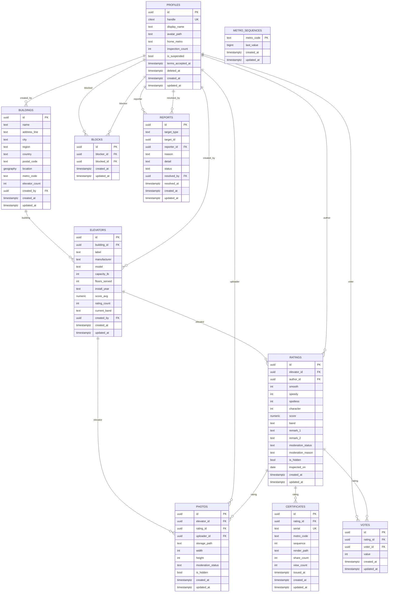

# ElaRater — architecture

One Expo codebase shipping to iOS, Android and web, on a Supabase backend, deployed
to Vercel. The certificate is the product: it is the rating result screen, the share
image, the web permalink and the marketing asset — one component, four uses.

The generated blocks below come from the live schema and the source tree. Regenerate
with `npm run gen:arch`; `npm run arch:check` fails if they are stale. A drift is a
broken doc, not a broken diagram.

- **Live:** https://elarater.vercel.app
- **Specs:** `docs/01` … `docs/07`. `CLAUDE.md` is the guardrail file.
- **Decisions:** `.claude/decisions/`

---

## The four layers

| Layer | Means | Here |
|---|---|---|
| **Front-end** | User interface | Expo SDK 57, Expo Router (file-based), React Native + react-native-web, `react-native-svg` |
| **Back-end** | Database | Supabase Postgres 17 + PostGIS, RLS on every table, triggers own every derived value |
| **Middleware** | APIs | `lib/api/*` over supabase-js, Zod at every boundary, TanStack Query, two Supabase Edge Functions, three Vercel Functions |
| **Infrastructure** | Container | Vercel (`web.output: "server"`), Supabase cloud via the Vercel Marketplace, local Supabase for dev, GitHub Actions |

---

## Inventory

<!-- generated:inventory -->
| Layer | Count | Detail |
|---|---|---|
| Front-end — routes | 13 | / · /(auth)/sign-in · /(auth)/terms-gate · /(tabs) · /(tabs)/profile · /c/[serial] · /delete-account · /elevator/[id] · /privacy · /rate/[elevatorId] · /settings · /settings/account · /terms |
| Front-end — primitives | 8 | FormLabel · TypedValue · Rule · StampSeal · Lantern · PaperSurface · WallSurface · ScoreDisplay |
| Front-end — other components | 6 | Certificate · Frame · SceneNodes · ActionButton · ReportSheet · LegalPage |
| Back-end — tables | 10 | blocks · buildings · certificates · elevators · metro_sequences · photos · profiles · ratings · reports · votes |
| Back-end — migrations | 15 | 0001_extensions.sql … 0015_service_role_grants.sql |
| Middleware — Supabase Edge Functions | 2 | delete-account · moderate-remarks |
| Middleware — Vercel Functions | 3 | c.ts · index.ts · og.ts |
<!-- /generated:inventory -->

---

## Backend ERD

<!-- generated:erd -->

<!-- /generated:erd -->

---

## Products and the tables they own

Every feature names the components it uses and the tables it owns. A table has one
owner; everything else reads it through `visible_ratings` or an RPC.

| Product | Components | Owns | Reads |
|---|---|---|---|
| **Certificate** | `Certificate` · `Frame` · `SceneNodes` · `lib/certificate/*` | `certificates`, `metro_sequences` | `ratings`, `elevators`, `buildings` |
| **Discovery** | `(tabs)/index` · `ScoreDisplay` · `PaperSurface` | — | `search_nearby_elevators` RPC |
| **Rating** | `rate/[elevatorId]` · `lib/offline/queue` | `ratings` | `elevators`, `profiles` |
| **Places** | `elevator/[id]` · `building/[id]` | `buildings`, `elevators` | `visible_ratings` |
| **Identity** | `(auth)/*` · `settings/*` · `lib/auth/*` | `profiles` | — |
| **Moderation** | `ReportSheet` · `moderate-remarks` · `delete-account` | `reports`, `blocks` | `ratings`, `photos`, `profiles` |
| **Sharing** | `lib/share` · `api/og.ts` · `api/c.ts` | — | `certificate_by_serial` RPC |
| **Legal** | `privacy` · `terms` · `delete-account` · `LegalPage` | — | — |

`photos` and `votes` have schema, RLS and grants but no v1 UI — both are v1-explicitly-not
scope in `docs/01-product-spec.md`, kept in the schema so the shape does not change later.

---

## Patterns

The governing principle is **minimal and repetitive**: a small set of component kinds
reused everywhere, rather than a new shape per feature. Before adding a component,
prove no existing one can be extended, and write the proof here.

| Pattern | Where it is used | Why it is the only one of its kind |
|---|---|---|
| **Eight primitives** | Every screen | `docs/04-design-system.md` fixes the set. There is no ninth. If a screen needs one, the screen is wrong. |
| **Scene graph** | `lib/certificate/geometry.ts` → `Node[]` | Two dumb translators consume it: `SceneNodes.tsx` (react-native-svg) and `to-svg-string.ts` (server). Neither knows a coordinate, so there is exactly one copy. |
| **Baked glyph outlines** | Certificate and `FormLabel` | Archivo is variable (wght 700 / wdth 88 is required) and native cannot select axes. Outlining at build time makes all four render paths identical and leaves the server SVG with zero `<text>`, so the rasteriser needs no fonts. |
| **Derived values are trigger-owned** | `score`, `band`, `serial`, `score_avg`, `rating_count`, `current_band`, `inspection_count` | The client is *refused* if it sends one. A single writer means no reconciliation logic anywhere. |
| **`visible_ratings`** | Every feed query | Block filtering lives in the view, in both directions, so no query can forget it. |
| **Zod at the boundary** | `lib/schemas/*` | Every network response is parsed before a component sees it. |
| **`lib/api/*` is the only Supabase caller** | Enforced by review | No component imports the client. |

### Two compositions that are deliberately not primitives

`ActionButton` and `LegalPage` compose existing primitives and introduce no new visual
idea. They exist because the same eight lines were appearing on every screen. Adding a
variant to either that changes how it *looks* rather than what it *says* means the
screen is wrong.

---

## Request flow — submitting a rating

```
four taps + up to two 48-char remarks
        │
        ▼  Zod (lib/schemas/rating.ts) — also rejects characters the certificate cannot draw
        ├─ offline? → lib/offline/queue.ts, optimistic certificate, flush on foreground
        ▼
  lib/api/ratings.createRating()
        │
        ▼  RLS: author is self, terms accepted, not suspended
  insert into ratings
        │
        ├─ BEFORE trigger  refuses a client-sent score/band, then derives both
        └─ AFTER trigger   allocates {METRO}-{000000} from metro_sequences,
                           inserts the certificate, recomputes elevators.score_avg
                           and profiles.inspection_count
        │
        ▼  moderation_status = 'pending' — NOT yet publicly readable
  moderate-remarks (Edge Function)
        │ approved
        ▼
  visible_ratings  →  client renders the certificate SVG
        │
        ▼
  /c/{SERIAL}  served by api/c.ts with per-request OG tags
  /api/og/{SERIAL}  →  geometry.ts → SVG → resvg → framed PNG
```

---

## Why `output: "server"` and not a static export

`docs/02-architecture.md` assumed a static export plus a Supabase Edge Function for OG
images. We run Expo Router's server output on Vercel instead — see
`.claude/decisions/0001-og-rendering-on-vercel.md`. The permalink is the whole growth
loop, and one runtime means one copy of the certificate geometry.

One wrinkle worth knowing: Expo prerenders a dynamic route **once**, into a shell whose
`<head>` still contains the literal `[serial]`. That shell is what gets served, so
`api/c.ts` re-serves it with the head rewritten per request. Humans get the identical
SPA and hydrate normally; scrapers get the real title, description and image. The
sentinel strings live in `lib/certificate/og.ts`, imported by both sides so they cannot
drift.

---

## Verification

| Command | Asserts |
|---|---|
| `npm run typecheck` | TypeScript strict, no `any` |
| `npm test` | Score rounding at every band boundary, remark moderation, seal arc-text orientation |
| `npm run verify:certificate` | Rasterised diff vs `brand/v3/certificate-hero.svg` — currently **0.005%** |
| `supabase db reset && npm run test:rls` | Schema builds from zero; 11 RLS negatives |
| `npm run arch:check` | This document is not stale |
